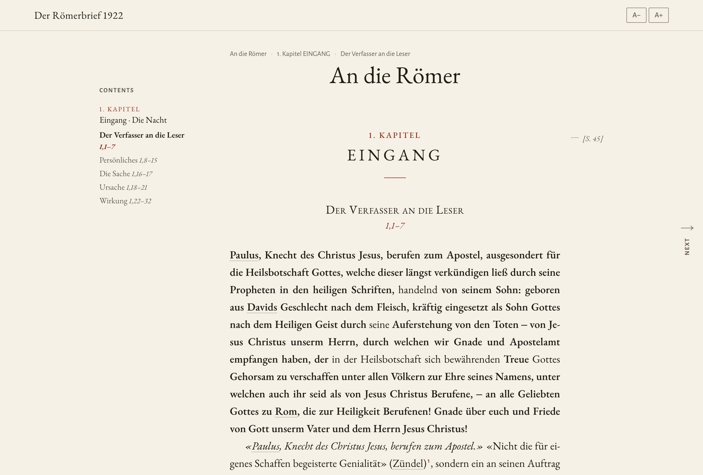
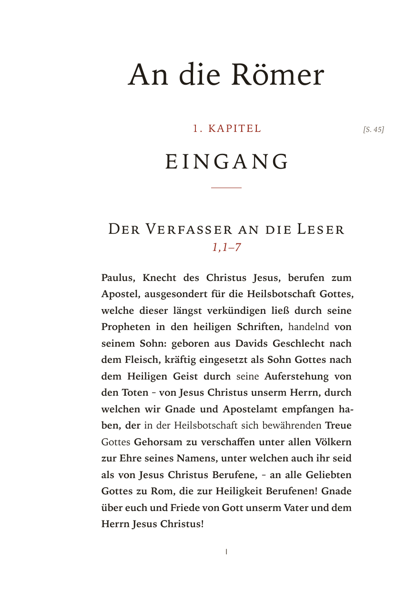
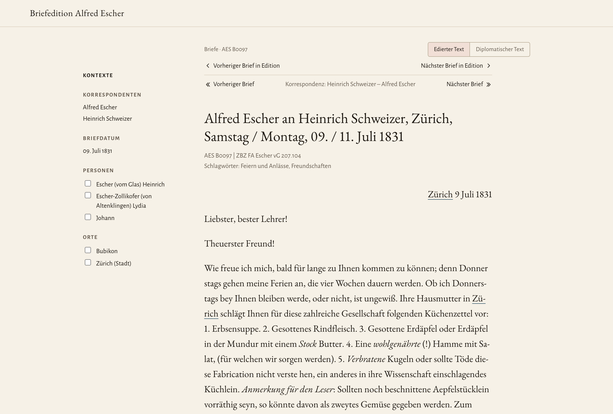
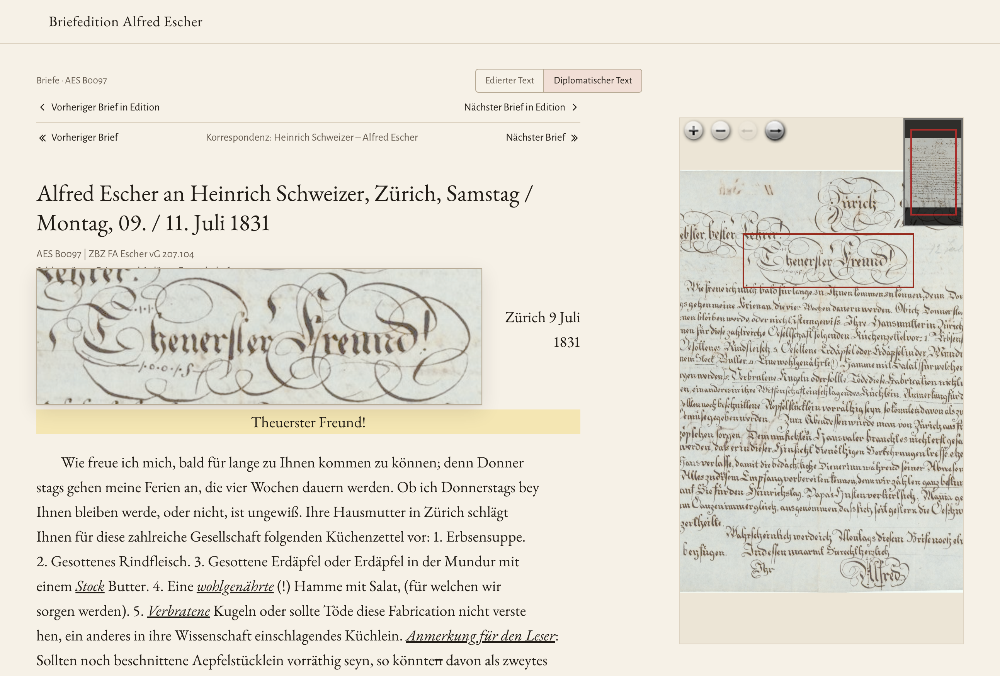
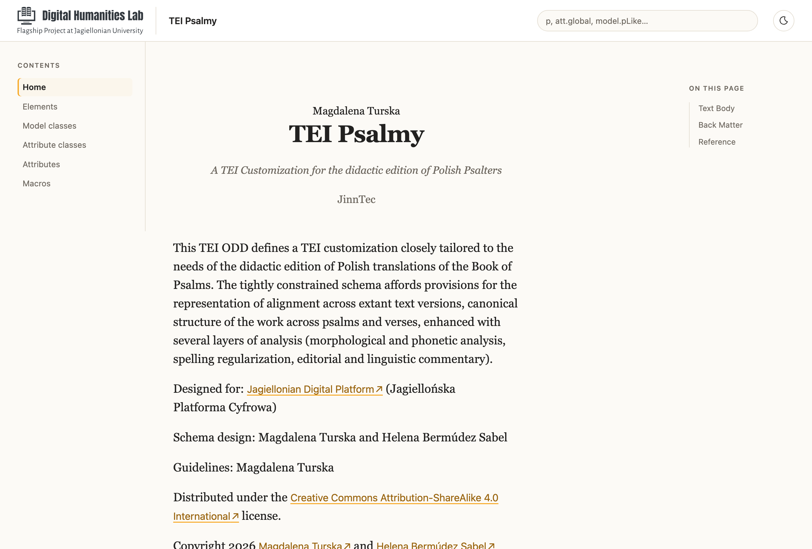
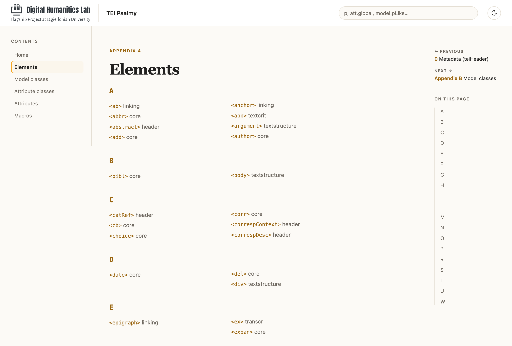
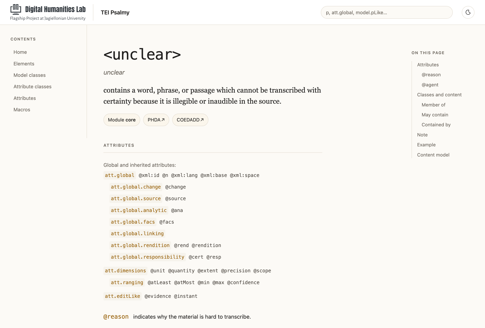

> Besides numerous bug fixes, this release supports generating documentation from existing ODDs, either as a static website, markdown, ePub or PDF. It also adds more examples, showcasing a nicely designed monograph as well as another correspondence edition with a switch between diplomatic and edited text. HTML templates and styling have been refactored to better support different designs while sharing the basic layout.

<iframe width="100%" height="540" src="https://www.youtube.com/embed/RGjD8LlWbRQ" title="OPM Release 0.10" frameborder="0" allow="accelerometer; autoplay; clipboard-write; encrypted-media; gyroscope; picture-in-picture; web-share" referrerpolicy="strict-origin-when-cross-origin" allowfullscreen></iframe>

## Documenting your ODD

As users of TEI Publisher or OPM, you are surely familiar with the ODD as the place to define processing model transformations. However, its main purpose is to document your entire encoding practice, including the customization of the TEI you are using, from which a formal schema can be compiled. And for sure, writing a documentation is only worth it if someone actually reads it.

OPM 0.10 thus adds a simple command to generate a nice static website from any ODD, which is pleasant to read and browse through:

```bash
# preview as static website
opm odd document <my.odd> --force --preview
# or in different formats
opm odd document <my.odd> -t typst      # a PDF
opm odd document <my.odd> -t markdown   # a Markdown file
opm odd document <my.odd> -t epub       # an e-book
# without ODD, it renders the latest version of the TEI P5 guidelines
opm odd document --force --preview
```

If your ODD contains prose, it will be included – otherwise you just get the reference pages. And while we were at it, we also added a command to generate a Relax NG schema. Please note that this is still experimental:

```bash
opm odd compile <my.odd> --format rng -o my.rng
```

## Reworked examples and base layout

The list of examples you can initialize with `opm init` is growing. Freshly included were:

* a __monograph__ example rendering one chapter of Karl Barth's _Der Römerbrief_. This focuses on using the same typography across different media formats.
* another __correspondence__ sample based on the _Alfred Escher Briefedition_. Here the focus is on switching between edited text and diplomatic view as well as the interaction with IIIF.

Looking at the growing number of examples, we also refactored the templates they use: examples now share a common base layout which adopts the concept of layout regions in TEI Publisher 11: concrete templates inherit from base and can fill the named regions known from TEI Publisher, i.e. `before`, `after`, `content` and so on.

## Why is it not 1.0 but 0.10?

This indicates that there still might be breaking changes before the 1.0. In particular this applies to page layouts and templates. However, the core should be stable and production ready.

<style>
#opm-samples-carousel {
  background: #eef0f2;
  border: 1px solid #dee2e6;
  border-radius: .5rem;
  overflow: hidden;
}
#opm-samples-carousel .carousel-item img {
  height: 440px;
  width: 100%;
  object-fit: contain;
  padding: 1.5rem 1.5rem 2.5rem;
  filter: drop-shadow(0 4px 10px rgba(0, 0, 0, .18));
}
#opm-samples-carousel .carousel-caption {
  position: static;
  height: 5rem;
  padding: .75rem 15% 0;
  background: #fff;
  border-top: 1px solid #dee2e6;
  color: var(--color-4);
}
#opm-samples-carousel .carousel-caption h5 {
  margin: 0 0 .25rem;
  font-size: 1.1rem;
}
#opm-samples-carousel .carousel-caption p {
  margin: 0;
}
#opm-samples-carousel .carousel-indicators {
  bottom: 5rem;
  margin-bottom: .6rem;
}
#opm-samples-carousel .carousel-control-prev,
#opm-samples-carousel .carousel-control-next {
  bottom: 5rem;
  width: 10%;
}
@media (max-width: 576px) {
  #opm-samples-carousel .carousel-item img { height: 320px; }
}
</style>
<div class="mb-4">
  <div id="opm-samples-carousel" class="carousel carousel-dark slide" data-bs-ride="carousel">
    <div class="carousel-indicators">
      <button type="button" data-bs-target="#opm-samples-carousel" data-bs-slide-to="0" class="active" aria-current="true" aria-label="Monograph sample"></button>
      <button type="button" data-bs-target="#opm-samples-carousel" data-bs-slide-to="1" aria-label="Monograph PDF sample"></button>
      <button type="button" data-bs-target="#opm-samples-carousel" data-bs-slide-to="2" aria-label="Edited letter sample"></button>
      <button type="button" data-bs-target="#opm-samples-carousel" data-bs-slide-to="3" aria-label="Diplomatic letter sample"></button>
      <button type="button" data-bs-target="#opm-samples-carousel" data-bs-slide-to="4" aria-label="ODD documentation home"></button>
      <button type="button" data-bs-target="#opm-samples-carousel" data-bs-slide-to="5" aria-label="ODD element index"></button>
      <button type="button" data-bs-target="#opm-samples-carousel" data-bs-slide-to="6" aria-label="ODD element reference"></button>
    </div>
    <div class="carousel-inner">
      <div class="carousel-item active">
        
        <div class="carousel-caption">
          <h5>Monograph as a web page</h5>
          <p>A chapter of Karl Barth's Römerbrief</p>
        </div>
      </div>
      <div class="carousel-item">
        
        <div class="carousel-caption">
          <h5>Monograph as PDF</h5>
          <p>The same chapter of the Römerbrief, ready for print</p>
        </div>
      </div>
      <div class="carousel-item">
        
        <div class="carousel-caption">
          <h5>Letter edition: edited text</h5>
          <p>Briefedition Alfred Escher</p>
        </div>
      </div>
      <div class="carousel-item">
        
        <div class="carousel-caption">
          <h5>Letter edition: diplomatic text</h5>
          <p>Hovering over a line shows its region in the facsimile</p>
        </div>
      </div>
      <div class="carousel-item">
        
        <div class="carousel-caption">
          <h5>ODD documentation</h5>
          <p>An ODD rendered as a documentation site</p>
        </div>
      </div>
      <div class="carousel-item">
        
        <div class="carousel-caption">
          <h5>ODD documentation: element index</h5>
          <p>All elements of the customization, grouped alphabetically</p>
        </div>
      </div>
      <div class="carousel-item">
        
        <div class="carousel-caption">
          <h5>ODD documentation: element reference</h5>
          <p>The reference page for &lt;unclear&gt;</p>
        </div>
      </div>
    </div>
    <button class="carousel-control-prev" type="button" data-bs-target="#opm-samples-carousel" data-bs-slide="prev">
      <span class="carousel-control-prev-icon" aria-hidden="true"></span>
      <span class="visually-hidden">Previous</span>
    </button>
    <button class="carousel-control-next" type="button" data-bs-target="#opm-samples-carousel" data-bs-slide="next">
      <span class="carousel-control-next-icon" aria-hidden="true"></span>
      <span class="visually-hidden">Next</span>
    </button>
  </div>
</div>

### Support e-editiones 

Remember: e-editiones is a non-profit association under Swiss law, recognised as serving the public benefit, with no commercial interests. As a consequence, e-editiones can only rely on membership fees to keep maintaining the software. Please consider [becoming a member](/pages/how-to-become-a-member/).

[Join e-editiones](/join) and follow us on [Mastodon](https://social.e-editiones.org/@eeditiones), [LinkedIn](https://www.linkedin.com/company/e-editiones/), [BlueSky](https://bsky.app/profile/e-editiones.bsky.social) and [Instagram](https://www.instagram.com/eeditiones/) for updates.